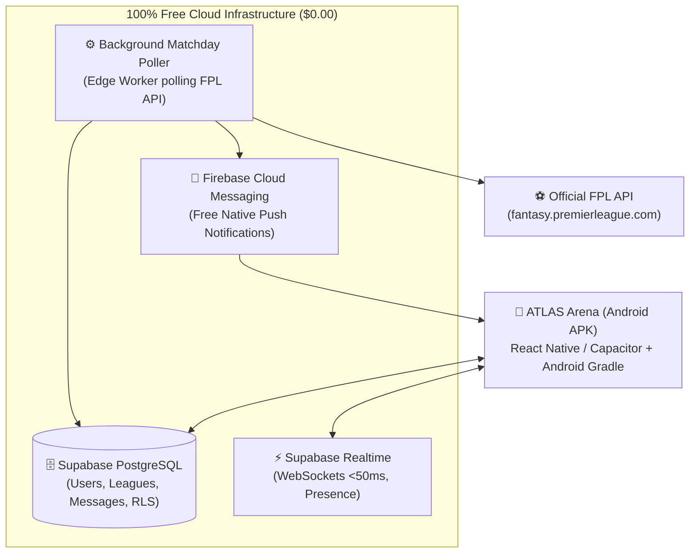

# 🏟️ ATLAS Arena — Master Product & Technical Blueprint
> **The Discord for Fantasy Football.** A dedicated native Android community app with real-time banter, smart matchday pings, automated event bot feeds, and zero-clutter starred mini-leagues.

---

## 🛡️ Workspace Boundary & Security Rules

> [!IMPORTANT]
> **Strict Confinement & Access Policy**:
> 1. **Primary Workspace Directory**: All new project files, code, Android Gradle wrappers, and configurations are strictly confined to:
>    ```text
>    /home/di3ces/Documents/ATLAS Arena/
>    ```
> 2. **External Directory Policy (Read-Only)**:
>    * All existing directories (such as `/home/di3ces/Documents/ATLAS Live`, `/home/di3ces/Documents/FPL Web App`, `/home/di3ces/Projects/atlas-hud`, etc.) are strictly **READ-ONLY**.
>    * They may be read for architectural reference, styles, or logic patterns, but **NO modifications, file creations, or deletions** will ever be made outside `/home/di3ces/Documents/ATLAS Arena/`.
> 3. **Isolation Guarantee**: The build environment, node modules, Gradle cache, and Git repository for ATLAS Arena will be 100% self-contained within its own folder.

---

## 🎯 1. Core Philosophy & Value Proposition

Traditional fantasy football platforms treat mini-leagues like static Excel spreadsheets. Discord and WhatsApp treat football like generic text chats.

**ATLAS Arena bridges the gap**:
1. **Dedicated Android Native App (`.apk`)**: Compiles with `./gradlew assembleDebug`, hardware-accelerated, native haptics, and system push notifications.
2. **The "Starred League" Paradigm**: Eliminates Discord’s cluttered server sidebar. The app boots **directly into the user's primary league**, with an elegant top dropdown for secondary leagues.
3. **Event-Driven Chat**: The FPL matchday injects live goal alerts, captain call-outs, and clean sheet losses directly into the conversation as rich interactive cards.
4. **$0.00 Forever**: Zero server costs using Supabase Free Tier, the official Premier League API, and Firebase Cloud Messaging (FCM).

---

## 📱 2. User Interface & Screen Architecture

```
┌────────────────────────────────────────────────────────┐
│ [≡]          ⭐ Saturday Banter League ▾         [👥 8] │ <- Top Bar
├────────────────────────────────────────────────────────┤
│  [#banter]    [#matchday-live]    [#h2h]    [#table]   │ <- Horizontal Channel Tabs
├────────────────────────────────────────────────────────┤
│                                                        │
│  [Bot] 🚨 GOAL: Bukayo Saka (74')                      │
│  ┌──────────────────────────────────────────────────┐  │
│  │  ARS 1 - 0 CHE                                   │  │
│  │  Scorer: Saka (+6 pts)  Assist: Odegaard (+3 pts)│  │
│  │                                                  │  │
│  │  📈 Impact:                                      │  │
│  │  • @Sumit [C] hauls +12 pts!                     │  │
│  │  • @Rahul lost Gabriel clean sheet               │  │
│  └──────────────────────────────────────────────────┘  │
│                                                        │
│  Rahul: @Sumit your captain luck is ridiculous 💀      │
│  Sumit: Cry more mate, Saka is inevitable 👑           │
│                                                        │
├────────────────────────────────────────────────────────┤
│  [+]  Message #banter...                       [ 🎤 ]  │ <- Discord-style Input Bar
└────────────────────────────────────────────────────────┘
```

### The 4 Dedicated Channel Tabs:
* **`#banter` (Main Chat)**: Text chat, replies, `@` user pings, custom football reactions (`⚽`, `🤡`, `🟥`, `👑`, `🔥`).
* **`#matchday-live` (Bot Feed)**: Filtered purely for automated match events (goals, assists, red cards, bonus point swings).
* **`#h2h` (Live Rivalry Matrix)**: Head-to-head match cards comparing live differential players and live point gaps.
* **`#table` (Live Standings)**: Real-time mini-league table updated dynamically with in-progress bonus points (BPS).

### The Slide-out Drawers:
* **Left Drawer (`[≡]`)**: League Switcher, User Profile settings, FPL team sync, theme settings.
* **Right Drawer (`[👥]`)**: Live Manager Roster:
  * 🟢 Green dots for managers currently active in the app.
  * Live Gameweek points & active captain pill (`[C: Isak]`).

---

## ⚡ 3. Smart FPL Pings & Mentions

| Syntax | Target | Trigger Scenario |
|---|---|---|
| `@Sumit` / `@Rahul` | Specific Manager | Direct banter or questions |
| `@captains-haaland` | All managers captaining Haaland | Haaland scores, blanks, or misses a penalty |
| `@arsenal-assets` | Managers with Arsenal defenders/keepers | 90th-minute clean sheet wipeout |
| `@bench-warmers` | Managers with 10+ points left on bench | Auto-tagged by bot at the end of Saturday |
| `@top4` | The league leaders | Major ranking shakeups on the podium |

---

## 🛠️ 4. Technical Architecture & $0.00 Stack



### Component Breakdown:
* **Client**: Android Native APK built via Gradle (`./gradlew assembleDebug`).
* **Realtime Messaging**: **Supabase Realtime** (Free 200 concurrent WebSockets, 2M messages/month).
* **Database**: **Supabase PostgreSQL** (Free 500MB tier with Row-Level Security).
* **Data Ingestion**: Serverless cron/poller fetching official Premier League matchday endpoints.
* **Push Notifications**: **Firebase Cloud Messaging (FCM)** (100% free unlimited push to Android).

---

## 🗄️ 5. Database Schema (Supabase PostgreSQL)

```sql
-- 1. Mini-Leagues
CREATE TABLE leagues (
    id UUID PRIMARY KEY DEFAULT gen_random_uuid(),
    fpl_league_id INTEGER UNIQUE NOT NULL,
    name TEXT NOT NULL,
    created_at TIMESTAMP WITH TIME ZONE DEFAULT NOW()
);

-- 2. League Members
CREATE TABLE league_members (
    id UUID PRIMARY KEY DEFAULT gen_random_uuid(),
    league_id UUID REFERENCES leagues(id) ON DELETE CASCADE,
    fpl_entry_id INTEGER NOT NULL,
    manager_name TEXT NOT NULL,
    team_name TEXT NOT NULL,
    pin_hash TEXT,
    is_starred BOOLEAN DEFAULT FALSE,
    last_seen TIMESTAMP WITH TIME ZONE DEFAULT NOW(),
    UNIQUE(league_id, fpl_entry_id)
);

-- 3. Messages & Embeds
CREATE TABLE messages (
    id UUID PRIMARY KEY DEFAULT gen_random_uuid(),
    league_id UUID REFERENCES leagues(id) ON DELETE CASCADE,
    channel TEXT NOT NULL DEFAULT 'banter', -- 'banter', 'matchday-live', 'h2h'
    sender_id UUID REFERENCES league_members(id),
    sender_name TEXT NOT NULL,
    is_bot BOOLEAN DEFAULT FALSE,
    content TEXT,
    embed_data JSONB, -- Stores goal card, scorer, points impact, team badges
    created_at TIMESTAMP WITH TIME ZONE DEFAULT NOW()
);

-- 4. Message Reactions
CREATE TABLE reactions (
    id UUID PRIMARY KEY DEFAULT gen_random_uuid(),
    message_id UUID REFERENCES messages(id) ON DELETE CASCADE,
    member_id UUID REFERENCES league_members(id) ON DELETE CASCADE,
    emoji TEXT NOT NULL,
    UNIQUE(message_id, member_id, emoji)
);
```

---

## 🚀 6. Step-by-Step Implementation Roadmap

### Phase 1: Android Shell & Discord Dark Theme
* [ ] Initialize the dedicated project directory (`atlas-arena`).
* [ ] Setup Discord Dark theme tokens (`#1e1f22`, `#2b2d31`, `#313338`, `#5865f2` Discord Blurple / `#00f0ff` Cyber Cyan).
* [ ] Build the mobile Discord shell:
  * Top navigation header with Starred League dropdown pill.
  * Channel switch bar (`#banter`, `#matchday-live`, `#h2h`, `#table`).
  * Right-side slide-over manager roster drawer.
  * Bottom Discord message bar with emoji button and send action.

### Phase 2: Supabase Real-Time Backend
* [ ] Provision free Supabase project.
* [ ] Run SQL migrations for `leagues`, `league_members`, `messages`, and `reactions`.
* [ ] Enable Realtime WebSockets on `messages` table for sub-50ms message delivery.
* [ ] Implement Presence tracking (shows green online indicator for league mates).

### Phase 3: FPL Ingestion & Starred League Onboarding
* [ ] Connect FPL API endpoint: fetch league title and roster via FPL League ID.
* [ ] "Claim My Team" frictionless onboarding: user taps their name, sets a quick 4-digit PIN.
* [ ] Local persistence: automatically star the league so the app launches straight into it.

### Phase 4: Matchday Bot & Live Embed Engine
* [ ] Event detection engine: poll live match fixtures for goals, assists, and red cards.
* [ ] Dynamic FPL Impact calculator: calculate which league members own the scorer/captain.
* [ ] Broadcast rich embed cards into `#matchday-live` and `#banter`.

### Phase 5: Android Build, Packaging & Push Notifications
* [ ] Wire up Gradle build configuration (`android/build.gradle`).
* [ ] Configure Android app icons, splash screen, and status bar colors.
* [ ] Compile debug APK: `./gradlew assembleDebug`.
* [ ] Integrate Firebase Cloud Messaging (FCM) for real system push notifications.
